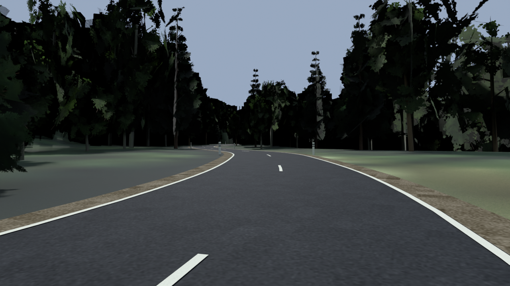

# AC Exelberg

A point-to-point hill-climb track for **Assetto Corsa** that recreates the road over the
**Exelberg** in Lower Austria / Vienna: from **Königstetten** over Dopplerhütte,
Scheiblingstein and the Exelberg down to the **Neuwaldegg roundabout** in Vienna, about
**15.9 km** of public road.

It comes as two tracks:

| Track folder | Name in game | Direction | Length |
| --- | --- | --- | --- |
| `exelberg_full_v014` | Exelberg Full v014 | Königstetten → Neuwaldegg roundabout (finish at its 2nd exit) | 15.9 km |
| `exelberg_reverse_v014` | Exelberg Reverse v014 | Neuwaldegg roundabout (1st exit, "Tulln") → Königstetten | 15.8 km |



> **Fan-made, non-commercial.** This is not an official product and is not affiliated with
> any road authority or with Kunos Simulazioni. The road and terrain come from public
> geodata, but road width, camber, grip and roadside objects are approximations. It is
> not a survey-accurate replica.

## Features

- Terrain from the Austrian 1 m airborne-laser terrain model (BEV ALS DTM), with a
  smoothed and designed road surface.
- Ground textures from BEV orthophotos, with a tiling grass detail layer and grass normal map on top.
- Asphalt with a surface normal map and specular map, plus a 60 m wear layer (patches,
  repair spots, sealed cracks) so the texture doesn't visibly repeat. The gravel shoulder
  has a normal map too.
- 3D grass clumps along both verges (about 95,000 per track), drawn near the camera.
  Works in the original game, no CSP needed.
- Trees placed from a canopy-height model (DSM − DTM).
- 300+ buildings from OpenStreetMap footprints, with heights from the laser surface model.
- Guide posts, guardrails, chevron boards, town and warning signs, plus the
  Richtfunkstation Exelberg radio tower as a landmark.
- The Neuwaldegg roundabout with zebra crossings, island planting and direction signs.
- Timed A2B runs with start and finish gates, and invisible containment walls 3 m beyond
  each road edge.
- AI line, so the in-game ideal line works.
- Three TV-style replay camera sets (switch with F3 in replays): broadcast, low trackside
  and high overview.
- All materials use the original Kunos shaders. The track runs fully without Custom Shaders
  Patch; with CSP, its GrassFX adds extra grass across the whole landscape.

## Installation

See **[INSTALL.md](INSTALL.md)**.

## Data sources and licenses

The track is built only from open data and from material made for this project:

| Data | Source | License |
| --- | --- | --- |
| Terrain model (ALS DTM, 1 m) | [BEV – Bundesamt für Eich- und Vermessungswesen](https://www.bev.gv.at/), [metadata](https://doi.org/10.48677/17e0f9fe-86d9-43b1-aaa6-5cf9538f8cf0) | [CC BY 4.0](https://creativecommons.org/licenses/by/4.0/) |
| Surface model (ALS DSM, 1 m) for tree and building heights | BEV | CC BY 4.0 |
| Orthophotos (DOP, Operat 2024460) | BEV, [metadata](https://doi.org/10.48677/1f33a105-0798-4696-92c2-df985c6f40a9) | CC BY 4.0 |
| Road alignment, junctions, roundabout, crossings, forest areas, building footprints | © [OpenStreetMap contributors](https://www.openstreetmap.org/copyright) | [ODbL 1.0](https://opendatacommons.org/licenses/odbl/1-0/) |
| Asphalt, gravel, grass, foliage and bark textures; grass-blade sprites (Asphalt015, Gravel023, Grass005, LeafSet014/016/019/024, Bark011/012/014, Foliage002/006/008) | [ambientCG](https://ambientcg.com/) | CC0 1.0 |
| Sign lettering | Liberation Sans fonts (rasterised into textures) | SIL Open Font License |
| Radio-tower height (109 m) | Wikipedia, "Richtfunkstation Exelberg" | fact only |

Everything else was made for this project: the road mesh, road markings, posts,
guardrails, sign drawings, facades, the map and the configs. All sign graphics are
simplified procedural drawings, not official sign artwork. Signs, guardrails and other
roadside objects were placed by hand from reference material. Their positions are
approximate, not surveyed.

**Attribution:** Terrain and orthophoto data © BEV, CC BY 4.0. Map data © OpenStreetMap
contributors, ODbL. The track package carries the full attribution text in
`ATTRIBUTION.txt`.

## How it is built

The pipeline is plain Python (NumPy, rasterio, pyproj, Pillow; see the `requirements-*.txt`
files) plus Blender for meshing and KN5 export.

1. **Acquisition.** Bounded HTTP range reads of the BEV rasters (only the road corridor,
   tens of MB rather than the multi-GB national files) and small OSM extracts.
2. **Route and road.** OSM ways are fitted into a smooth centreline, draped on the DTM and
   given a designed grade profile. The road ribbon is ±3 m of asphalt with a gravel
   shoulder.
3. **Terrain.** A watertight collision skin follows the DTM, blends into the road
   shoulders and is textured with orthophoto chunks.
4. **Scenery.** Trees come from the canopy-height model, buildings from OSM, and
   signs/posts/guardrails from a placement generator. Everything is exported as a second,
   visual-only KN5. Verge grass clumps are placed on the grass part of the ground skin and
   exported as a third, visual-only KN5.
5. **Materials.** Road, shoulder and ground materials are switched to
   `ksPerPixelMultiMap_NMDetail` by rewriting only the texture/material header of the KN5;
   the meshes stay byte-identical.
6. **AI line and cameras.** The AI spline is generated from the road centreline with a
   speed profile. Replay cameras are placed with line-of-sight checks against terrain, trees
   and buildings.
7. **Packaging.** The KN5s, AC configs, map, UI and attribution are packed, with offline
   checks for spawn heading, gate positions, skin coverage and file hashes.

Scripts are versioned by track iteration (`scripts/*_v0NN.py`). The current release is
**v014**. The repository holds the code, tests and documentation only. Raw geodata,
intermediate rasters, Blender scenes and built packages are not committed. They are
large, and they can be regenerated or downloaded from the sources above.

```sh
python3 -m venv .venv
.venv/bin/pip install -r requirements-terrain.txt -r requirements-v004.txt -r requirements-v014.txt
.venv/bin/python -m unittest discover -s tests -q   # most tests need the generated data
```

Documentation: [status / changelog](docs/STATUS.md),
[data-source register](docs/DATA_SOURCES.md), [coordinate frame](docs/decisions/COORDINATES.md),
[v011 test guide](docs/FULL_TRACK_V011_TEST_GUIDE.md),
[v012 test guide (AI line, cameras)](docs/FULL_TRACK_V012_TEST_GUIDE.md).

## Known limitations

- Road width (2 × 3 m), camber and grip are nominal values, not measurements.
- The other roundabout arms and side roads are visual only, closed off by invisible walls.
- One pit box, so no AI opponents. Built for solo practice and hotlapping. The AI line
  follows the road centreline, not a racing line.
- VR and performance on low-end PCs have not been tested much.
